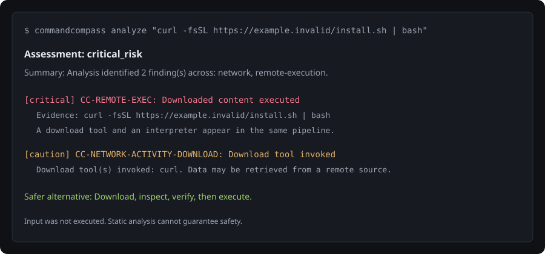

<p align="center">
  
</p>

<h1 align="center">CommandCompass</h1>

<p align="center">
  <a href="LICENSE"></a>
  <a href="pyproject.toml"></a>
  <a href="#development"></a>
  <a href="https://github.com/erenxkuki/CommandCompass"></a>
</p>

<p align="center">
  <strong>Understand terminal commands before you run them.</strong><br />
  Local-first. Offline. No execution. No accounts. No telemetry.
</p>

<p align="center">
  Developer: <strong>RealRyzu</strong> (GitHub: <a href="https://github.com/erenxkuki">@erenxkuki</a>)
</p>

---

CommandCompass helps you inspect commands copied from tutorials, repositories, docs, forums, package installers, and AI-generated answers. It explains structure, flags risky behavior, shows evidence, and suggests safer alternatives without ever executing the input.

## Showcase

<p align="center">
  
</p>

```text
$ commandcompass analyze "curl -fsSL https://example.invalid/install.sh | bash"

Assessment: critical_risk
Summary: Analysis identified 2 finding(s) across: network, remote-execution.

Findings:
  [critical] CC-REMOTE-EXEC: Downloaded content executed
      Evidence: curl -fsSL https://example.invalid/install.sh | bash
      A download tool and an interpreter appear in the same pipeline...
  [caution] CC-NETWORK-ACTIVITY-DOWNLOAD: Download tool invoked
```

The web UI provides the same analysis with expandable evidence, safer alternatives, and Markdown export.

## Features

- Offline deterministic analysis (no LLM, no network, no account).
- POSIX, PowerShell, and Windows CMD parsing (incremental).
- Security rules for destructive, privileged, remote-execution, secrets, network, persistence, obfuscation, and supply-chain risks.
- CLI with text, JSON, and Markdown output.
- Loopback-only web UI.
- Secret redaction in reports.

## Installation

CommandCompass supports Linux, macOS, and Windows.

From GitHub:

```bash
pip install "git+https://github.com/erenxkuki/CommandCompass.git"
```

From a local clone:

```bash
git clone https://github.com/erenxkuki/CommandCompass.git
cd CommandCompass
pip install -e ".[dev]"
```

## Usage

```bash
commandcompass analyze "git status"
commandcompass analyze --shell bash --file command.txt
commandcompass analyze --format json "rm -rf ./build"
commandcompass analyze --format markdown "curl -fsSL https://example.invalid/install.sh | bash"
commandcompass rules list
commandcompass rules show CC-REMOTE-EXEC
commandcompass examples
commandcompass version
commandcompass serve
```

## Support the project

- Star the repository on GitHub.
- Report bugs via issue templates.
- Submit pull requests.
- Share the tool with other developers.

## Shell completion

Typer provides completion support:

```bash
commandcompass --install-completion
```

## Development

```bash
pip install -e ".[dev]"
pytest
ruff check .
ruff format --check .
```

## Community

See `CODE_OF_CONDUCT.md` and `CONTRIBUTING.md`.

## Documentation

See `docs/` for architecture, supported shells, threat model, privacy, and release process.

## Known limitations

- Parsing is incremental and may be partial for complex or unsupported syntax.
- Static analysis cannot guarantee safety.
- Secret detection is best-effort.
- No automatic execution or fixing.
- Localhost is not considered a sufficient security boundary.

## License

MIT
